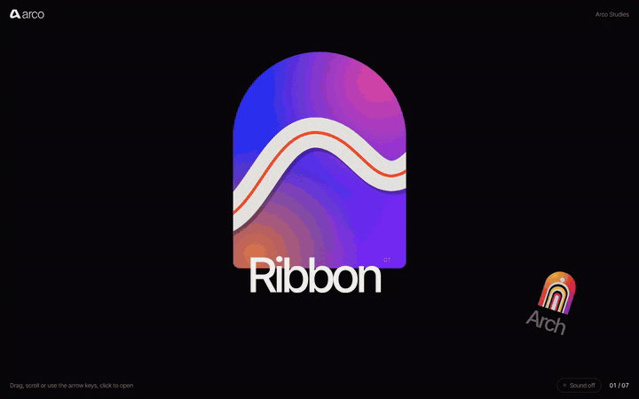
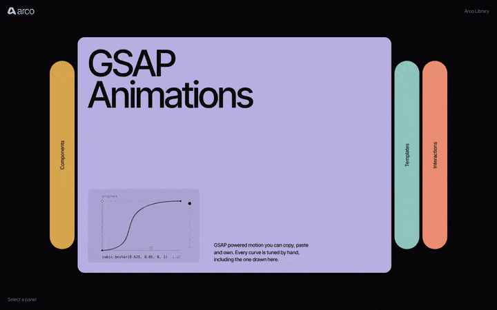
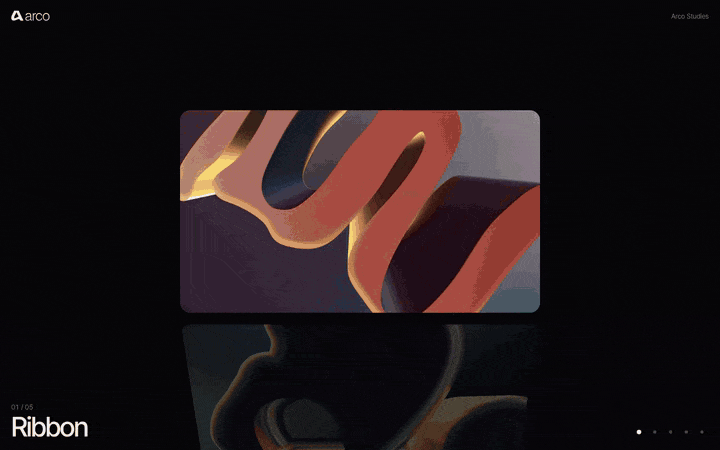
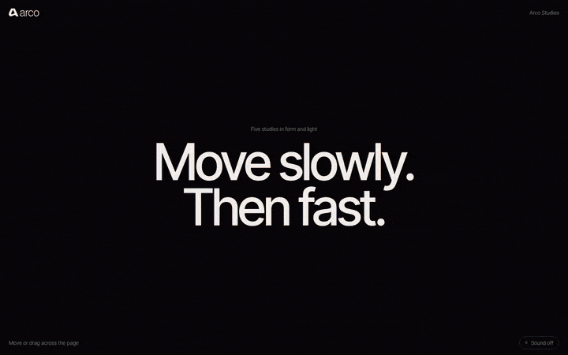

# Arco

GSAP components for Webflow and the web, by [Emanuel Bento](https://emanuelbento.pt).

Each component is a folder with three files: the HTML structure, the CSS and the JS. They share the same design tokens, type and easing, so they sit together on one page. Class names follow Finsweet Client-First, so they map straight onto a Webflow build.

**[See them running live in the Lab →](https://emanuelbento.pt/lab)**



## Components

| Component | What it does | GSAP |
| --- | --- | --- |
| [Accordion](#accordion) | Panels that expand on hover | Flip, SplitText, CustomEase |
| [Cylinder Stack](#cylinder-stack) | Cards turning on a 3D cylinder as you scroll | ScrollTrigger, CustomEase |
| [Cursor Trail](#cursor-trail) | An image trail that follows the cursor | Core |
| [Orbit](#orbit) | Navigation laid out on an arc you drag, scroll or tab through | Draggable, InertiaPlugin, CustomEase |

---

### Accordion



[Live demo](https://emanuelbento.pt/lab/accordion) · [CodePen](https://codepen.io/emanuelbento/pen/ByWYrNm)

Expanding panels that open on hover. Flip handles the resize, SplitText masks the title lines, and three CustomEase presets (`signature`, `smooth`, `snappy`) set the feel. Stacks vertically on phones and portrait tablets.

Inspired by an effect from [Made With GSAP](https://madewithgsap.com). Rebuilt from scratch.

**Files**
- `accordion.html`: HTML structure
- `accordion.css`: Styles and CSS variables
- `accordion.js`: Animation logic

**Dependencies**
- GSAP 3.15
- Flip 3.15
- SplitText 3.15
- CustomEase 3.15

**Options**

| Attribute | Default | |
| --- | --- | --- |
| `data-arco-active` | `0` | Panel open on load |
| `data-arco-trigger` | `hover` | `hover` or `click`. Touch always uses click |
| `data-arco-ease` | `signature` | `signature`, `smooth` or `snappy` |

---

### Cylinder Stack



[Live demo](https://emanuelbento.pt/lab/cylinder-stack) · [CodePen](https://codepen.io/emanuelbento/pen/JoRqopX)

A pinned scroll section where cards turn on a 3D cylinder. ScrollTrigger pins the section and snaps to each card, the active card lights up while the rest fall into shadow, and the label swaps with a masked transition. Dots jump to any card. With reduced motion the cards crossfade in place.

**Files**
- `cylinder-stack.html`: HTML structure
- `cylinder-stack.css`: Styles and CSS variables
- `cylinder-stack.js`: Animation logic

**Dependencies**
- GSAP 3.15
- ScrollTrigger 3.15
- CustomEase 3.15

**Options**

Card labels come from `data-label` on each card. Card size and perspective are CSS variables (`--arco-cylinder-width`, `--arco-cylinder-perspective`). The angle and gap between cards are `STEP` and `GAP` at the top of the JS.

---

### Cursor Trail



[Live demo](https://emanuelbento.pt/lab/cursor-trail) · [CodePen](https://codepen.io/emanuelbento/pen/MYjdXEK)

An image trail that follows the cursor. Images are spaced by distance, drift in the direction of movement and fade out, and a few keep appearing while the cursor rests. An optional ambient chord reacts to speed. Works with touch, and with reduced motion the images appear without rotation or drift.

**Files**
- `cursor-trail.html`: HTML structure
- `cursor-trail.css`: Styles and CSS variables
- `cursor-trail.js`: Animation and sound

**Dependencies**
- GSAP 3.15

**Options**

The trail images are the `` tags inside `.arco-cursor-trail_sources`, so in Webflow they can come from a CMS collection. Image size is `--arco-trail-size`. Spacing, drift and timing are constants at the top of the JS.

---

### Orbit


[Live demo](https://emanuelbento.pt/lab/orbit) · [CodePen](https://codepen.io/emanuelbento/pen/gbmoPby)

Navigation laid out on an arc. The links sit on a wide circle whose centre is below the stage, so only the top of the curve shows: the active link at the keystone, its neighbours leaning away down the slope.

- **Turn.** Drag with inertia, scroll or use the arrow keys, Home and End. It always settles on a link, and the wheel hands back to the page at either end.
- **Preview.** An arch shows the active item, each new image rising from its base, and leans with the speed of the turn. Side links carry a small arch of their own image.
- **Open.** Click the active link or the arch and it grows into a full bleed image, the arc drops away and the bar text switches ink to stay readable. Esc, Close or a click on the image goes back.
- **Sound.** Optional, off until the toggle is pressed. Each link has its own note, so turning the arc plays a scale. Also plays on iPhones in silent mode.
- **Accessible.** The links stay a normal list: tabbing turns the arc and screen readers read them in order.

**Files**
- `orbit.html`: HTML structure
- `orbit.css`: Styles and CSS variables
- `orbit.js`: Animation logic

**Dependencies**
- GSAP 3.15
- Draggable 3.15
- InertiaPlugin 3.15
- CustomEase 3.15

**Options**

| Attribute | Default | |
| --- | --- | --- |
| `data-arco-orbit-start` | `0` | Link active on load |
| `data-arco-orbit-wheel` | `true` | `false` leaves the mouse wheel to the page |
| `data-arco-orbit-thumbs` | `true` | `false` hides the small arches above the side links |
| `data-arco-orbit-open` | `true` | `false` makes the active link follow its href instead of opening the image |
| `data-arco-orbit-ink` | `light` | On each `.arco-orbit_image`. Set `dark` for light images, so the bars switch to dark text when it opens |

The height of the arc and the size of the preview are CSS variables (`--arco-orbit-top`, `--arco-orbit-media-top`, `--arco-orbit-media-height`). Events: `arco:change`, `arco:open` and `arco:close`. In Webflow the links can be a Collection List: give the list the class `arco-orbit_list` and each item `arco-orbit_item`. The preview images can be a second Collection List inside `arco-orbit_media`, in the same order.

---

## Usage

1. Add the font and the component CSS inside `<head>`.
2. Paste the HTML structure where the component should appear.
3. Add GSAP, the plugins the component needs, and the component JS before `</body>`, in that order.
4. Replace the images and copy with your own.

Every HTML file starts with a comment listing exactly what to add. With jsDelivr, for example:

```html
<link rel="stylesheet" href="https://cdn.jsdelivr.net/gh/emanuelbento/arco-components@1.1.0/components/accordion/accordion.min.css">

<script src="https://cdn.jsdelivr.net/npm/gsap@3.15/dist/gsap.min.js"></script>
<script src="https://cdn.jsdelivr.net/npm/gsap@3.15/dist/Flip.min.js"></script>
<script src="https://cdn.jsdelivr.net/npm/gsap@3.15/dist/SplitText.min.js"></script>
<script src="https://cdn.jsdelivr.net/npm/gsap@3.15/dist/CustomEase.min.js"></script>
<script src="https://cdn.jsdelivr.net/gh/emanuelbento/arco-components@1.1.0/components/accordion/accordion.min.js"></script>
```

jsDelivr minifies `.min.js` and `.min.css` on request. Pin a version tag in production; branch URLs like `@main` are cached for days.

### In Webflow

1. **CSS:** Page settings > Custom code > *Inside `<head>` tag*. Use Site settings instead if the component appears on more than one page.
2. **HTML:** rebuild the structure in the Navigator with the same Client-First classes, so the component stays editable in the Designer and the CMS can drive the content. An Embed element works for a quick test.
3. **JS:** Page settings > Custom code > *Before `</body>` tag*, after GSAP and its plugins. If the site already loads GSAP through Webflow, skip those script tags so it is never loaded twice.
4. Custom code does not run on the Designer canvas. Check the result in Preview or on the staging domain.

### Initialising

Components start on their own when the page loads. For content added later, or after a page transition (Barba, Swup), call `init` on the new container:

```js
ArcoAccordion.init(container);
ArcoCylinderStack.init(container);
ArcoCursorTrail.init(container);
ArcoOrbit.init(container);
```

Each instance is stored on its element (`el.arcoAccordion`, `el.arcoCylinderStack`, `el.arcoCursorTrail`, `el.arcoOrbit`) and has a `destroy()` method.

## Design tokens

All components read the same tokens from `:root`, so changing one changes the whole library.

| Token | Default |
| --- | --- |
| `--arco-stage` | `#08070a` |
| `--arco-ink-invert` | `#f2f0ed` |
| `--arco-ink-muted` | `rgb(242 240 237 / 0.45)` |
| `--arco-font` | `"Inter Tight", "Neue Haas Grotesk Display", "Helvetica Neue", Helvetica, Arial, sans-serif` |
| `--arco-stage-pad` | `1.25rem` |
| `--arco-bar-height` | `3.5rem` |

## Accessibility

Controls are real buttons with visible focus. Decorative layers are hidden from screen readers. Every component respects `prefers-reduced-motion`, and Cursor Trail and Orbit sound stays off until the toggle is pressed.

## Browser support

Current versions of Chrome, Edge, Firefox and Safari 16 or later.

## License

[MIT](LICENSE). Emanuel Bento.
